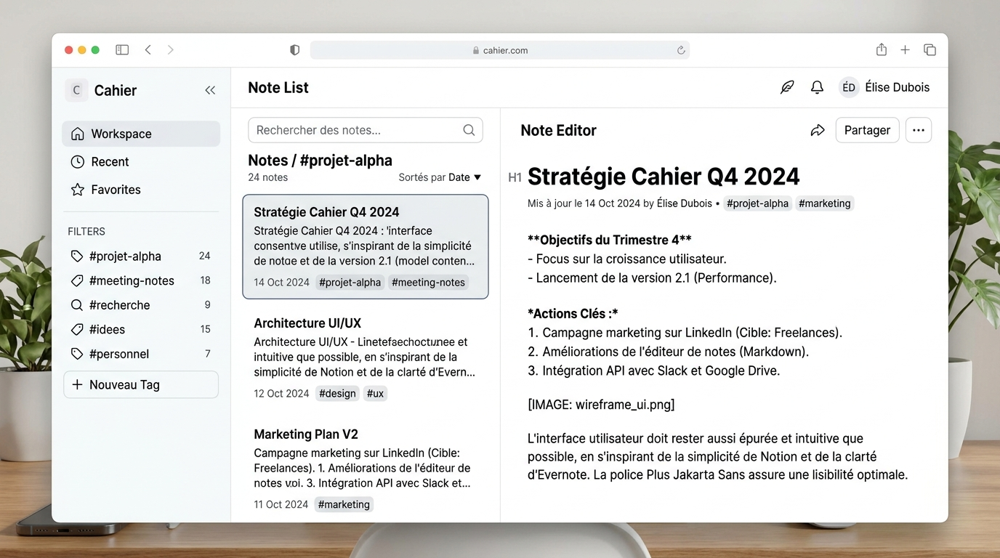
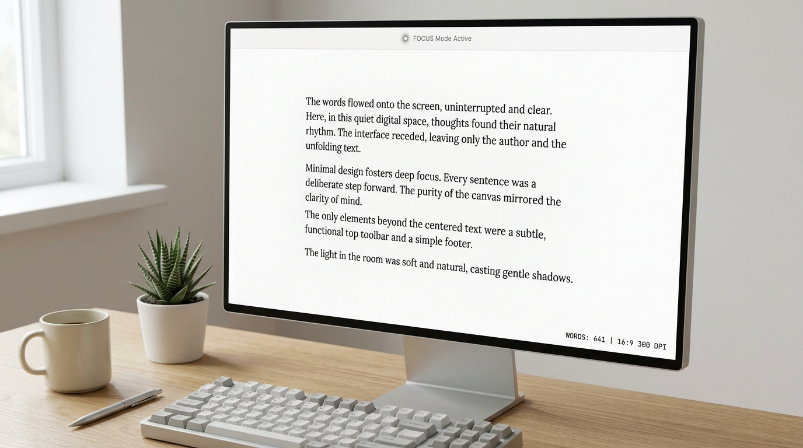
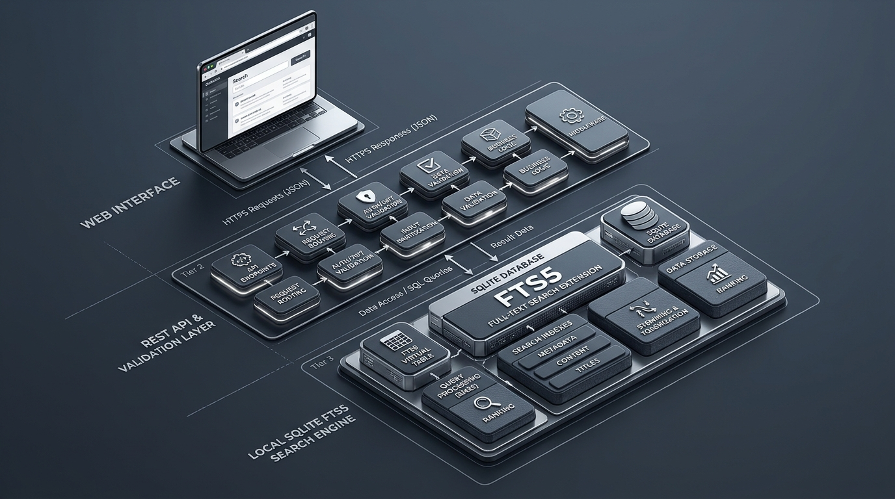

# Cahier — Application de Prise et d'Organisation de Notes

**Projet conçu, développé et documenté par : Mendel Temgoua**

Application professionnelle de prise, d'organisation, de recherche plein texte et d'archivage de notes avec sauvegarde persistante, **Mode Focus sans distraction**, interface Web épurée et outil **CLI**.

---

## Galerie Visuelle & Captures du Projet

### 1. Espace de travail principal (3 panneaux épurés)

*Figure 1 — Espace de travail organisé en trois zones : barre latérale de filtres et tags, liste de recherche instantanée et éditeur éditorial.*

### 2. Mode Focus — Écriture plein écran sans distraction

*Figure 2 — Le Mode Focus (`Ctrl + \`) masque la barre latérale et la liste des notes pour offrir une feuille d'écriture centrée maximale.*

### 3. Architecture Technique en 3 Couches

*Figure 3 — Séparation stricte entre l'Interface Web (Front-End), la couche de validation REST API et le moteur de persistance et d'indexation plein texte SQLite FTS5.*

---

## 1. Analyse Produit & Cadrage

### 1.1 Objectif Produit et Philosophie d'Isolation
- **Zéro pollution du Front-End par le Back-End** : Le serveur Back-End n'injecte aucune fausse donnée ou note de démonstration automatique dans le Front-End au démarrage, et l'interface utilisateur n'expose aucun identifiant interne (`ID`), log serveur ou détail technique de base de données. Seules les notes créées par l'utilisateur s'affichent.
- **Utilisateurs cibles** :
  - **Professionnels & Chefs de projet** : prise de notes de réunion, suivi d'actions, épinglage des documents de référence et archivage des sujets clôturés.
  - **Ingénieurs, Chercheurs & Étudiants** : rédaction au calme grâce au **Mode Focus**, classement par tags normalisés (`#architecture`, `#projet`, `#idée`) et recherche plein texte instantanée.

### 1.2 Fonctionnalités Principales
- **CRUD Complet** : Créer, lire, éditer et supprimer définitivement (avec double confirmation de sécurité).
- **Mode Focus Intégré** : Masque en un clic (`Ctrl + \` ou bouton **« Mode Focus »**) la barre latérale et la liste des notes pour maximiser l'espace d'écriture.
- **Recherche Plein Texte (FTS5)** : Recherche instantanée (`Ctrl + K`) sur le titre, le contenu et les tags, insensible aux accents et à la casse.
- **Organisation par Tags** : Ajout et suppression de tags avec normalisation automatique et filtrage dynamique dans la barre latérale.
- **Archivage & Restauration** : Déplacement des notes terminées dans les archives avec horodatage dédié (`archived_at`) et restauration en un clic.
- **Horodatage & Métriques** : Dates de création, de modification et d'archivage, compteur de mots/caractères et temps de lecture estimé (`~X min de lecture`).
- **Sauvegarde Persistante & Export JSON** : Stockage automatique sur disque et téléchargement d'une archive JSON portable en un clic.

---

## 2. Guide Utilisateur

### Interface Web (Port 3000)
1. **Créer une note** : Cliquez sur **« Nouvelle note »** en haut à droite. Saisissez votre titre et votre texte.
2. **Activer le Mode Focus** : Cliquez sur **« Mode Focus »** en haut à gauche de l'éditeur (ou appuyez sur `Ctrl + \`). La barre latérale et la liste disparaissent. Appuyez sur `Échap` pour réafficher les panneaux.
3. **Enregistrer** : Cliquez sur **« Enregistrer »** ou appuyez sur `Ctrl + S` (`Cmd + S`).
4. **Ajouter des tags** : Dans la ligne `Tags :` sous le titre, tapez un mot-clé dans `+ Ajouter un tag...` puis appuyez sur `Entrée`.
5. **Rechercher** : Appuyez sur `Ctrl + K` et saisissez vos mots-clés pour filtrer instantanément vos notes.
6. **Consulter la Documentation illustrée** : Cliquez sur **« Documentation »** dans la barre de navigation supérieure pour afficher la documentation complète avec photos directement dans l'application.

### Interface en Ligne de Commande (CLI)
```bash
# Consulter les statistiques
npm run cli -- stats

# Créer une note depuis le terminal
npm run cli -- create --title="Ma note" --content="Contenu de la note" --tags="projet,perso"

# Lister les notes actives
npm run cli -- list --status=active

# Rechercher en plein texte
npm run cli -- search "projet"

# Archiver, restaurer ou supprimer une note
npm run cli -- archive <note_id>
npm run cli -- restore <note_id>
npm run cli -- delete <note_id>
```

---

## 3. Documentation de l'API REST (`/api`)

| Méthode | Route | Description | Corps / Paramètres | Codes HTTP |
| :--- | :--- | :--- | :--- | :--- |
| `GET` | `/api/health` | Vérification de l'état du service | — | `200` |
| `GET` | `/api/notes` | Liste et recherche plein texte des notes | Query: `q`, `tag`, `status` (`active`\|`archived`\|`all`), `sort` | `200`, `400` |
| `GET` | `/api/notes/export` | Export complet des notes en JSON | — | `200` |
| `GET` | `/api/notes/:id` | Détail d'une note | Param: `id` | `200`, `404` |
| `POST` | `/api/notes` | Création d'une note | `{ "title": string, "content": string, "tags"?: string[], "is_pinned"?: boolean }` | `201`, `400`, `415` |
| `PUT` | `/api/notes/:id` | Mise à jour d'une note | `{ "title"?: string, "content"?: string, "tags"?: string[], "is_archived"?: boolean, "is_pinned"?: boolean }` | `200`, `400`, `404`, `415` |
| `PATCH` | `/api/notes/:id/archive` | Archivage ou restauration d'une note | `{ "is_archived": boolean }` | `200`, `400`, `404`, `415` |
| `DELETE` | `/api/notes/:id` | Suppression définitive d'une note | Param: `id` | `200`, `404` |

---

## 4. Installation, Tests & Déploiement

```bash
# 1. Installer les dépendances
npm install

# 2. Démarrer l'application en développement (http://localhost:3000)
npm run dev

# 3. Vérifier le typage TypeScript (Lint)
npm run lint

# 4. Exécuter les tests unitaires, d'intégration et E2E
npm test

# 5. Compiler pour la production
npm run build
```

---

## 5. Crédits & Auteur

- **Auteur & Réalisation** : **Mendel Temgoua**
- **Licence** : Apache-2.0
