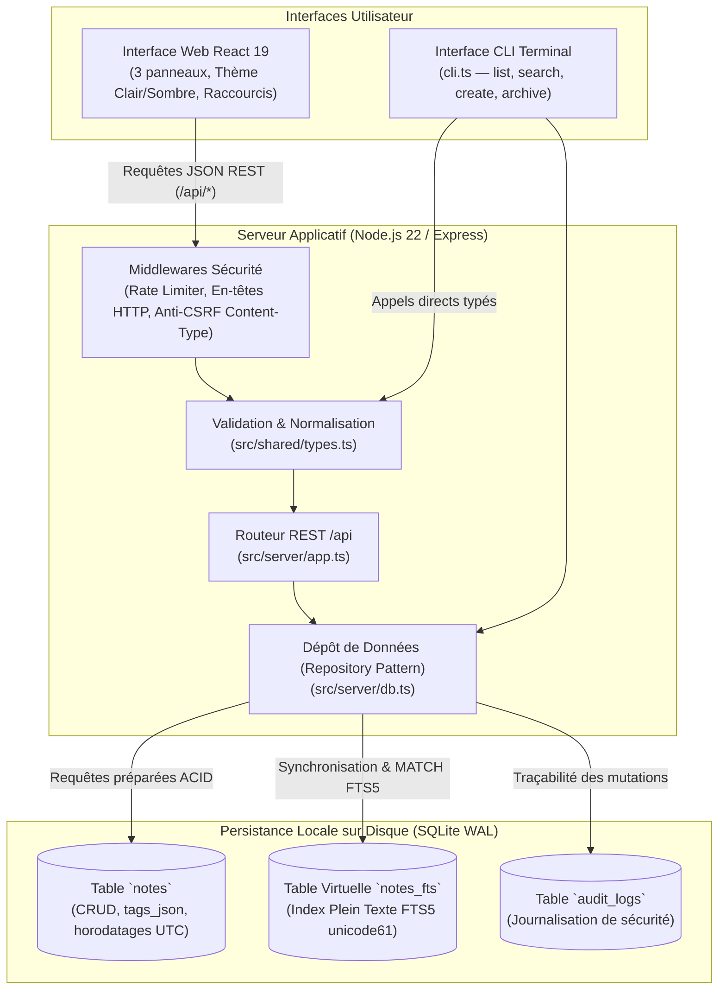

# Architecture Logicielle — Cahier (Application de Notes)

## 1. Vue d'ensemble et Justification de la Stack

La stack retenue est **Node.js 22 (TypeScript strict) + SQLite (`node:sqlite` avec extension FTS5) + Express + React 19 (Tailwind CSS v4) + CLI**.

### Pourquoi cette architecture par rapport à Python + SQLite ?
1. **Fidélité au moteur de persistance demandé (SQLite)** : L'application utilise nativement **SQLite** en mode **WAL (`Write-Ahead Logging`)** avec une table virtuelle **FTS5 (`notes_fts`)** et le tokenizer `unicode61 remove_diacritics 2`, garantissant une recherche plein texte insensible à la casse et aux accents sur le titre, le corps et les tags.
2. **Double interface (Web légère + CLI)** : Le projet expose à la fois une interface Web réactive (port 3000) et une interface en ligne de commande (`npm run cli -- ...`) qui partagent exactement le même dépôt de données SQLite (`src/server/db.ts`) et les mêmes validateurs (`src/shared/types.ts`).
3. **Zéro surcharge de dépendances binaires externes** : L'utilisation du module natif `node:sqlite` intégré à Node.js 22 élimine les risques de chaîne d'approvisionnement (supply-chain) liés aux bindings C++ tiers (`node-gyp`) tout en offrant un typage strict de bout en bout entre le serveur, l'API et le client.

---

## 2. Diagramme d'Architecture (Mermaid)

---

## 3. Séparation des Couches (Layered Architecture)

| Couche | Fichier(s) | Responsabilités |
| :--- | :--- | :--- |
| **Contrats & Domaine** | `src/shared/types.ts` | Modèles TypeScript stricts (`Note`, `AuditLogEntry`, `TagStat`), normalisation des tags (`normalizeTag`), calcul des métriques (`computeTextMetrics`) et validation des entrées (`validateCreateNoteInput`, `validateUpdateNoteInput`). |
| **Accès aux Données (DAL)** | `src/server/db.ts`, `migrations/001_initial_schema.sql` | Encapsulation de `DatabaseSync` (`node:sqlite`), gestion du schéma et des migrations, synchronisation de l'index plein texte FTS5 (`notes_fts`), requêtes paramétrées et écriture du journal d'audit. |
| **API & Sécurité** | `src/server/app.ts`, `server.ts` | Exposition REST (`/api/notes`, `/api/tags`, `/api/audit`, `/api/health`), limitation de débit par IP, vérification `Content-Type: application/json`, en-têtes HTTP de sécurité. |
| **Présentation Web** | `src/App.tsx`, `src/services/notesApi.ts` | Espace de travail responsive à 3 colonnes, recherche instantanée avec debounce, filtres par statut et par tag, éditeur temps réel avec horodatages et lecteur du journal d'audit. |
| **Interface CLI** | `cli.ts` | Outil en ligne de commande permettant de lister, chercher en plein texte, créer, archiver, restaurer et supprimer des notes depuis un terminal. |

---

## 4. Modèle de Données et Schéma SQLite

### 4.1 Table `notes`
- `id` (`TEXT PRIMARY KEY`) : Identifiant UUIDv4 préfixé (`note_<uuid>`).
- `title` (`TEXT NOT NULL`) : Titre validé (1 à 200 caractères).
- `content` (`TEXT NOT NULL`) : Corps de la note (jusqu'à 50 000 caractères).
- `tags_json` (`TEXT NOT NULL`) : Tableau JSON de tags normalisés en minuscules (max 15 tags de 32 caractères).
- `is_archived` (`INTEGER NOT NULL DEFAULT 0`) : Booléen (0 = active, 1 = archivée).
- `is_pinned` (`INTEGER NOT NULL DEFAULT 0`) : Booléen (0 = standard, 1 = épinglée en tête).
- `word_count` / `char_count` (`INTEGER NOT NULL`) : Compteurs calculés à chaque écriture.
- `created_at` (`TEXT NOT NULL`) : Horodatage de création au format ISO 8601 UTC.
- `updated_at` (`TEXT NOT NULL`) : Horodatage de dernière modification au format ISO 8601 UTC.
- `archived_at` (`TEXT NULL`) : Horodatage d'archivage (ou `NULL` si la note est active).

### 4.2 Table Virtuelle `notes_fts` (SQLite FTS5)
- Colonnes : `note_id UNINDEXED`, `title`, `content`, `tags_text`.
- Tokenizer : `unicode61 remove_diacritics 2` (permet de trouver `"réunion"` en cherchant `"reunion"` et supporte la recherche par préfixe `"mot"*`).

### 4.3 Table `audit_logs`
- Enregistre chaque événement sensible (`NOTE_CREATE`, `NOTE_UPDATE`, `NOTE_ARCHIVE`, `NOTE_RESTORE`, `NOTE_PIN`, `NOTE_UNPIN`, `NOTE_DELETE`) avec `entity_id`, `entity_title`, `actor`, `details` et `created_at`.

---

## 5. Modèle de Permissions et Sécurité (Défense en Profondeur)

1. **Principe du moindre privilège** : Le processus applicatif n'accède qu'au répertoire `data/` local pour le fichier SQLite. Aucune exécution shell dynamique ni évaluation de code (`eval`) n'est présente.
2. **Prévention des injections SQL et FTS5** :
   - Toutes les requêtes SQL utilisent des instructions préparées (`db.prepare(...).run(...)`).
   - Les requêtes utilisateur destinées au moteur plein texte passent par `buildSafeFtsQuery()`, qui neutralise les opérateurs spéciaux FTS5 (`"`, `*`, `(`, `)`, `^`, `:`) et encadre chaque terme en préfixe sécurisé `"terme"*`.
3. **Prévention XSS et CSRF** :
   - Échappement natif React côté client (aucun `dangerouslySetInnerHTML`).
   - Vérification stricte de l'en-tête `Content-Type: application/json` sur toutes les routes de mutation (`POST`, `PUT`, `PATCH`), bloquant les soumissions de formulaires cross-origin simples.
4. **Protection contre les abus de débit (DoS / Rate Limiting)** :
   - Limite de taille du payload JSON fixée à `256kb`.
   - Limiteur de débit par IP configurable via `RATE_LIMIT_MAX_REQUESTS` (par défaut 180 requêtes / minute).
